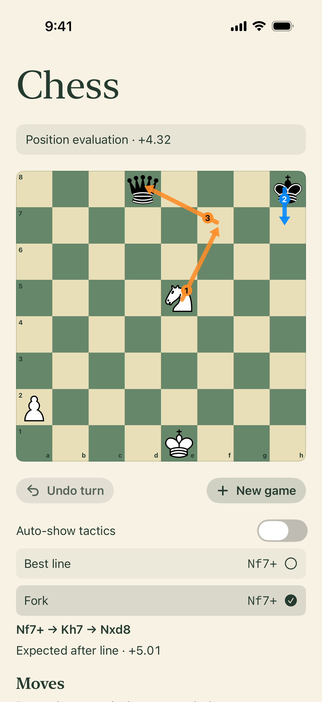

# Chess Tactics Coach

Chess Tactics Coach is a native SwiftUI iPhone app for playing chess offline against a computer and learning tactics during the game. Stockfish 18 evaluates the board and supplies a best line. The coach also looks for tactical opportunities and labels recognizable patterns such as forks, pins, skewers, and discovered attacks.

## Play and learn

- **Play as White or Black.** Tap or drag a piece to move it. The board flips for Black, and the computer varies its play across games.
- **Get a hint on your turn.** Tap **Show tactic**, or turn on **Auto-show tactics** to get a suggestion on each of your turns.
- **Compare suggestions.** Tap a named tactic or **Best line** to see its numbered arrows, move sequence, and expected evaluation. The board shows one line at a time.
- **Review your position.** The move list uses algebraic notation. **Undo turn** takes back your move and the computer’s reply, keeping White’s opener when you play Black.

The current and projected scores are in pawn units from your perspective. Positive scores favor your side. The projected score evaluates the board reached after the displayed moves, including the predicted reply. Some tactics require a longer search than the coach’s short lines.

## Run in Xcode

1. Open `ChessTacticsCoach.xcodeproj`.
2. Select the **ChessTacticsCoach** scheme and an iPhone simulator running iOS 17 or later.
3. Press **⌘R** to build and run. Press **⌘U** to run the tests.

The first build downloads about 113 MB of Stockfish neural networks, verifies their SHA-256 checksums, and bundles them. The installed app runs offline. To run on a physical iPhone, choose a development team under **Signing & Capabilities** and select the phone as the run destination.

## Engine and credits

- **Stockfish 18** scores the current position and suggested lines. The bundled source is in `Stockfish/src` at revision `cb3d4ee9b47d0c5aae855b12379378ea1439675c` (tag `sf_18`). [Upstream source](https://github.com/official-stockfish/Stockfish/tree/sf_18) · [GPLv3 license](Stockfish/Copying.txt)
- **chess.js 1.4.0** handles the rules in JavaScriptCore. A separate local opponent varies its moves among similarly scored options. Games are held in memory, and threefold repetition and the fifty-move rule are treated as automatic draws. [chess.js license](Coach/ChessJS-LICENSE.txt)
- **Cburnett pieces** by Colin M.L. Burnett are bundled from Lichess under GPL v2 or later. The ChessFox tactics list informed the motif labels. [Artwork attribution](Coach/Cburnett-NOTICE.txt) · [ChessFox tactics list](https://chessfox.com/chess-tactics-list/)
